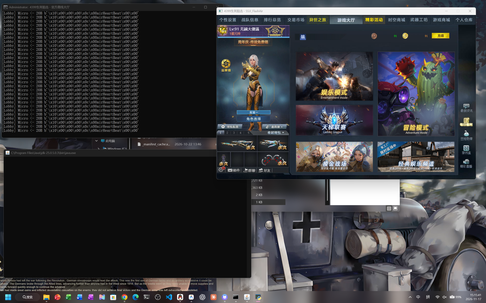
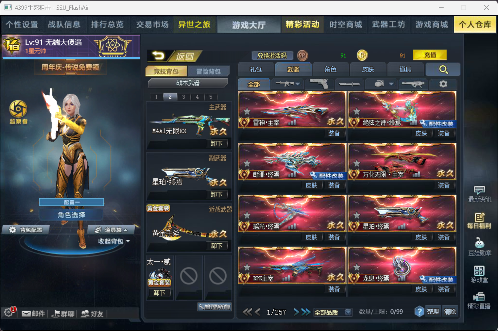
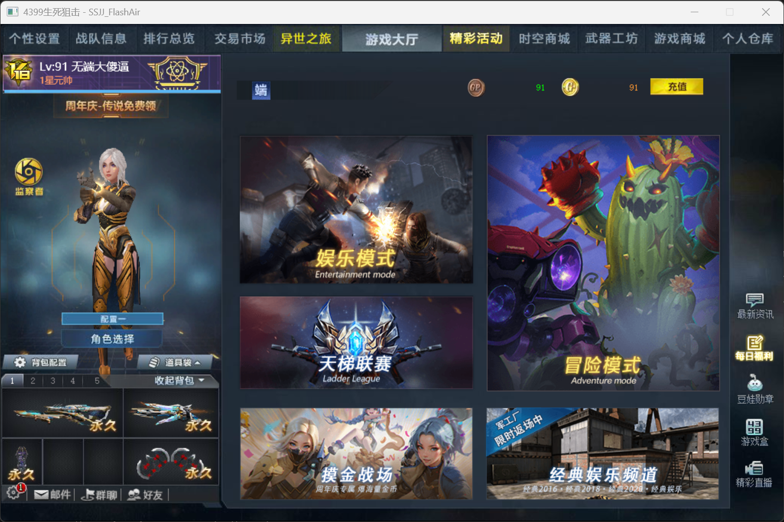
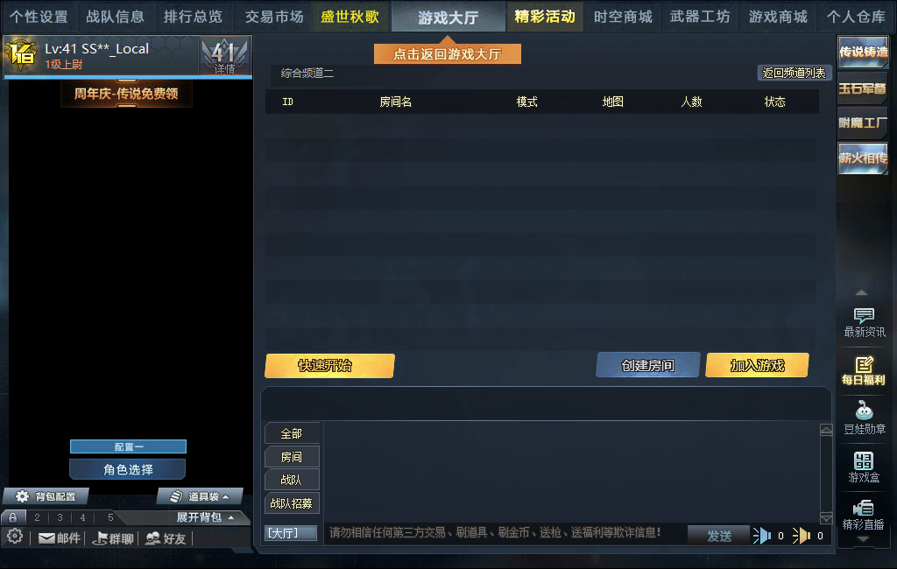

# SSJJ-Source — 生死狙击离线复刻与 Server-First 开源框架

> **定位声明**：本项目是一个**开源框架与实验性复刻工程**，旨在通过社区协作还原《生死狙击》离线/局域网体验。欢迎志同道合的开发者加入共建（协议逆向、武器技能、人机 AI、地图玩法、大厅联调等）。

---

## 核心架构与开源模块

本项目同时包含两条技术路线及配套资源工具：

1. **Server-First 独立服务端框架（当前主线，`SSJJ-Server/`）**
   - 保持原版 Unity 战斗客户端 `Assembly-CSharp.dll` **零改动**，通过 `-la <base62(ProtoBuf(BootConfigData))>` 原生启动参数直连本地 `SSJJ-Server`（TCP `:27100` / UDP `:27101`）。
   - 接入官方共享契约与原生物理引擎（`WizzardEngine.dll` + PhysX / BSP 碰撞），实现移动、弹道、击杀播报、准星红叉、计分板与多模式回合结算。
   - 已包含团队（2003/3）、刀锋战士/刀战（15/2041）、爆破（2，含 C4 下包/拆包）、个人竞技（5）、死斗（12）、武器大师（64）、飞刀（74）、大头英雄（2019/19）等模式框架及 `VerifyE2E` 端到端测试套件（`_work/VerifyE2E/`）。

2. **官方 AIR 大厅与本地网关（`_work/lobby_host/` + `_work/launch_lobby.py`）**
   - Java AMF3 大厅服务端（`LobbyLoginServer.java`）、本地 HTTP 资源网关（`_work/gateway_8080.py`）与战斗启动桥接（`_work/launch_battle_from_lobby.py`）。
   - 支持大厅登录、仓库/背包/皮肤/角色配置同步、创建房间并一键拉起战斗端。

3. **旧版离线注入模式（`Game-SSJJ-Source/Assets/Decompiled/Offline*.cs`）**
   - 早期基于客户端注入的离线单人游玩实现（含 `OfflineGameController.cs`、`OfflineBotAI.cs`、`OfflineGameplay.cs` 等），保留供参考与对比。

4. **Python 资源拉取与工具脚本（`Game-SSJJ/tools/`、`_work/`、`tools/`）**
   - 包含资源下载、清单解析、AssetBundle 校验与启动准备脚本。

---

## 界面与工程预览

### AIR 大厅实机预览






---

## 目录结构

```text
SSJJ-Source/
├── SSJJ-Server/                  # C# (.NET 10) Server-First 权威服务端框架
│   ├── Program.cs                # 主循环、玩家步进与网络调度
│   └── src/
│       ├── Bots/                 # 人机 AI 与 BSP 导航图
│       ├── Config/               # 武器/技能/皮肤数据表与 BSP 地图解析
│       ├── GameModes/            # 爆破/刀战/团队/武器大师/大头/飞刀模式协调器
│       ├── NativeEngine/         # WizzardEngine / PhysX 原生宿主
│       ├── Network/              # TCP 信令网关 & UDP 快照/UserCmd 同步
│       ├── Physics/              # 官方物理适配与 Quake3 Pmove
│       ├── QuakeServer/          # 武器、伤害、投掷物与技能特效系统
│       └── Snapshot/             # 原生 ParseOld 快照序列化器
├── _work/
│   ├── VerifyE2E/                # 端到端协议与玩法自动化测试
│   ├── lobby_host/               # Java AMF3 大厅服务端与清单配置
│   ├── gateway_8080.py           # 本地 :8080 资源网关
│   ├── launch_lobby.py           # 大厅一键启动器
│   ├── launch_battle_from_lobby.py # 大厅 -> 战斗端桥接启动
│   └── launch_server_client.py   # 独立直连调试启动器
├── Game-SSJJ-Source/Assets/Decompiled/Offline*.cs # 旧版离线注入模式源码
├── Game-SSJJ/tools/              # 资源处理与辅助 Python 脚本
└── docs/images/                  # 开源预览截图
```

---

## 快速开始（开发者）

1. **环境要求**：`.NET 10 SDK`、`Python 3.10+`、`Java 17+`（AIR 大厅）。
2. **编译服务端 & 运行 E2E 测试**：
   ```powershell
   dotnet build SSJJ-Server\SSJJ-Server.csproj -v minimal
   dotnet run --project _work\VerifyE2E\VerifyE2E.csproj
   ```
3. **启动大厅**：
   ```powershell
   python -u _work\launch_lobby.py
   ```

> **版权说明**：本仓库**不包含**任何原厂客户端二进制文件、美术模型、贴图或加密资源包，仅开源自主编写的服务端框架、大厅桥接与工具脚本源码。
